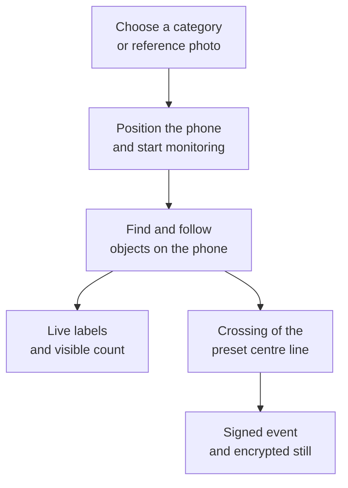
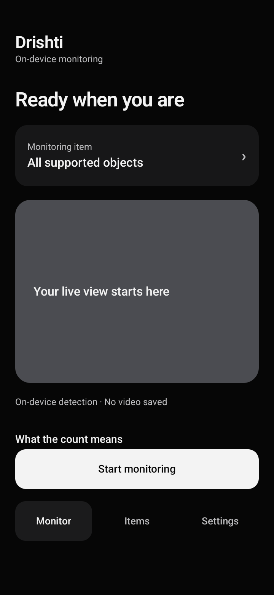
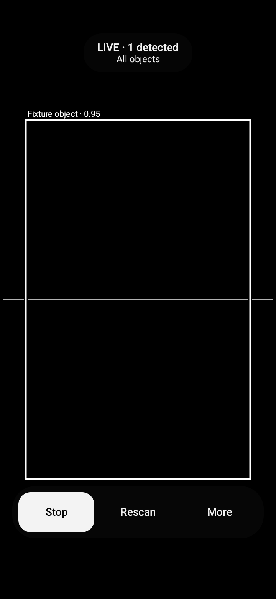
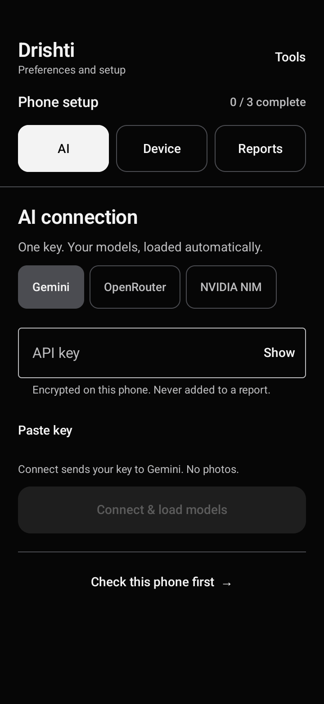
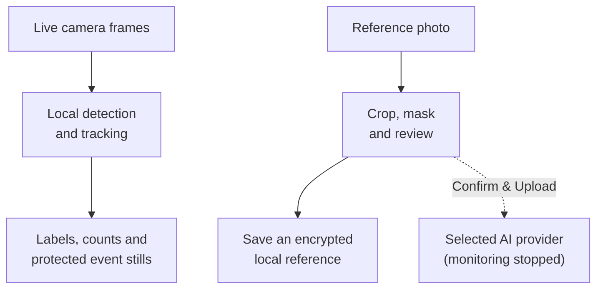

# Drishti

**Use an Android phone to see and record inventory movement.**

Drishti is a prototype that uses a phone's camera to find items, follow their movement and keep a record that a person can review. Live monitoring runs on the phone. An optional AI photo description helps with item setup.

Our goal is simple: **help people see what moved, in which direction, and what evidence was recorded.**

> **Development prototype · v0.6.4 · Updated 31 October 2026**
>
> Detection, tracking and event recording are implemented. Reliable construction-site counting still needs field testing.

[Our goal](#what-we-are-trying-to-achieve) · [How it works](#how-it-works) · [Screens](#a-look-at-the-app) · [Get started](#get-started) · [Development](#build-from-source)

## What we are trying to achieve

Material movements are easy to miss when records depend on someone watching an entrance and writing down every trip. Drishti aims to make those movements easier to review using an existing Android phone.

We are working toward three outcomes:

- **See the item.** Show a label and a box around a supported object or a visual match to a saved reference.
- **Follow its movement.** Track the object across nearby camera frames and notice when it crosses a counting line.
- **Keep evidence.** Save a protected still image and a signed event record for later review.

**An intended use case:** a supervisor fixes a phone near a material-storage entrance. Items pass through its view. Drishti records possible inward and outward movements for comparison with a human tally.

Construction materials such as cement bags are part of this goal. **The bundled detector has not been trained specifically for cement bags.** This example is an intended workflow, not a passed field trial.

## How it works



The current counting gate is a preset line near the centre of the camera view. Downward crossings are **OUT**; upward crossings are **IN**. Choosing a custom line position is still planned.

The phone scans at startup, when motion wakes the detector, when you tap **Rescan**, and periodically to find items that are already standing still. Two recent frames are kept in memory to help catch the start of movement. The app does not save video recordings.

### What the numbers mean

| Number | Meaning |
| --- | --- |
| Visible count | Objects seen across enough recent camera frames to be shown as present. |
| IN / OUT crossings | Objects followed across multiple frames that have crossed the preset line in each direction. |
| Inventory balance | Not yet a validated stock total. Opening stock, missed items and other stock changes are not fully accounted for. |

Seeing the same four objects again does not mean four new items arrived. Losing and recreating a track can still affect crossing totals. A match score is also not a measured accuracy percentage.

## A look at the app

<table>
  <tr><th>Monitor</th><th>Live view</th><th>Settings</th></tr>
  <tr>
    <td></td>
    <td></td>
    <td></td>
  </tr>
</table>

These previews show the real app screens filled with test data. Example boxes, counts and ready states illustrate the layout; they are not construction-site results.

- **Monitor** — start or stop a session, see live matches and request another scan.
- **Items** — choose a supported category or create an encrypted photo reference.
- **Settings** — connect a provider, check the phone and choose a report folder. Optional request history is under **Tools → API activity**.

## Get started

Use an Android phone with a supported camera. Android 8.0 or later is required, and the phone must pass the app's processing-speed check. Build and install the app using the development instructions below.

1. **Connect a provider in Settings.** Enter your own Gemini, OpenRouter or NVIDIA NIM key inside the app. Tap **Connect & load models** and choose an available model. NVIDIA also requires model verification.
2. **Prepare the phone.** Run the device check. This measures local processing speed and prepares the key used to sign event records.
3. **Choose a report folder.** Select storage on the phone, an SD card or a USB drive.
4. **Add an item.** Choose a trained category, or take/select a photo. Adjust the crop, mask private details, tap **Use this crop**, name the item and save it.
5. **Start monitoring.** Keep the phone steady and the item visible as it crosses the line. Use **Rescan** for a fresh scan and **Stop** to end the session.

**Current setup requirement:** the prototype requires a provider connection before monitoring can start, even if you plan to monitor offline. Once setup is complete, live monitoring does not make network requests.

A reference photo asks the app to look for a similar appearance. It does **not** train a new detector. Lighting, angle, size and background can change the result. AI-generated names and descriptions are editable setup notes; they do not teach the detector a new category.

## Privacy and data



| Activity | Where it happens |
| --- | --- |
| Live matching and tracking | On the phone, with no monitoring network traffic. |
| Saved references and event stills | Encrypted on the phone. Event images use a limited storage archive. |
| Provider connection and model discovery | Online, after an explicit Connect, Refresh or Verify action. |
| Optional AI photo description | Online, only for the reviewed crop after a fresh **Confirm & Upload** tap while monitoring is stopped. |
| Report export | To a local folder chosen by the user. |

Keys are entered only in the app and stored encrypted. No credentials are bundled. Provider-reported token usage is recorded when available; missing usage and prices stay unknown.

Digital signatures help detect later changes to records. **A valid signature shows record integrity; it does not prove that an object was identified or counted correctly.**

Private state is excluded from Android backup and device transfer. Uninstalling the app or clearing its data can lose local records and keys. Exported reports do not restore private signing keys.

## Current progress

| Area | Current state |
| --- | --- |
| Camera monitoring | Working prototype with live labels, Start/Stop, Rescan and motion-based scanning. |
| General object categories | The bundled detector covers 80 standard categories; it is not a construction-material-specific model. |
| Custom photo references | Experimental visual matching is implemented. |
| Photo setup | Scroll, corner drag, mask, crop approval and offline save verified in focused real-phone tests. |
| Crossing records | Counter and signed, encrypted event storage are implemented. Reliable site counting still needs field validation. |
| Cloud descriptions | Consent and usage recording are implemented. Live photo-analysis verification remains open. |
| Interface | Three tabs, aligned controls and native button animations with reduced-motion support. |

### Verification snapshot

Recorded on **31 October 2026**. See [current status](docs/STATUS.md) and [UI verification](docs/UI_POLISH.md) for evidence and limitations.

| Check | Recorded result |
| --- | --- |
| Kotlin core tests | 68 passed. |
| Android build and lint | Passed; app and test APKs built. |
| Android emulator suite | 31/32 passed, no skips. The pinned cow-image detection test still fails at its configured threshold. |
| Focused physical-phone tests | 5/5 passed for crop/setup and button motion, not field accuracy. |
| Python tests | 14 passed, plus 3 exporter-interface tests. |
| Python dependency audit | No known vulnerabilities reported at that check. |

These are local results. No GitHub Actions workflow is currently configured.

### What success still needs

Before treating Drishti as a dependable site-counting tool, we need to:

- Train and validate the intended material categories using real construction-site examples.
- Compare results with an independent reference count, including at least 500 crossings per site.
- Measure sustained speed, heat, memory use and an eight-hour battery run on physical phones.
- Check interruption recovery, alarms and the absence of monitoring network traffic under real Android conditions.

These checks remain open. A successful build or interface test does not complete them.

## Build from source

### Requirements

- Android Studio and Android SDK 37.
- A compatible JDK. This workspace was verified with Android Studio's bundled JBR 25; the app targets Java 17 bytecode.
- Python for report verification and its tests.

```powershell
git clone https://github.com/Parag-Y-26/monitoring-.git
cd monitoring-
```

Open the project in Android Studio and select its bundled JDK for Gradle, or set `JAVA_HOME` before using the wrapper.

```powershell
.\gradlew.bat :core:check :app:assembleDebug :app:assembleDebugAndroidTest :app:lintDebug
python -m pip install -r tools/requirements.txt
python -m unittest discover -s tests -v
```

On macOS/Linux, use `./gradlew` instead of `.\gradlew.bat`. The debug APK is generated at `app/build/outputs/apk/debug/app-debug.apk`.

Use a **disposable emulator or separate test installation** for automated device tests. Test cleanup has previously removed the app and its saved setup. APK retention is enabled, but it is not a backup. See [the incident and safeguard](docs/UI_POLISH.md#device-test-cleanup-incident).

### Code map

| Location | Responsibility |
| --- | --- |
| `app/` | Android screens, camera service, local storage, device keys and approved cloud requests. |
| `core/` | Detection maths, tracking, crossing logic and signature verification that can be tested without a phone. |
| `tools/` | Report verification, test tooling and model preparation. |
| `tests/` | Python checks for report integrity and model-tooling behavior. |
| `docs/` | Build requirements, decisions, verification evidence and field-test plans. |

Kotlin and Jetpack Compose provide the interface. CameraX supplies camera input. Bundled YOLOX-Tiny models run through LiteRT for local detection. Room/SQLCipher and Tink protect local data. Docker is used for model conversion during development; it is not an app backend.

Internal identifiers still use `com.edgepulse.monitor` and related EdgePulse names for compatibility with existing installations and audit records. **Drishti** is the user-facing name.

## Project documentation

| Document | Purpose |
| --- | --- |
| [Build contract](docs/BUILD_CONTRACT.md) | Agreed scope, boundaries and five construction phases. |
| [Current status](docs/STATUS.md) | Implemented work, measured evidence and open checks. |
| [UI and motion](docs/UI_POLISH.md) | Crop repair, navigation, animations and device-test evidence. |
| [Item monitoring](docs/ITEM_MONITORING_PLAN.md) | Category detection and photo-reference matching. |
| [Model preparation](docs/MODEL_PREPARATION.md) | Model sources, conversion, calibration and licensing evidence. |
| [Audit protocol](docs/AUDIT_PROTOCOL.md) | How signed records are created and verified. |
| [Field tests](docs/FIELD_TESTS.md) | Real-world checks still needed. |
| [Decisions](docs/DECISIONS.md) | Reasons for important implementation choices. |

The build contract and recorded user amendments take precedence over the original specification where they differ. Bundled YOLOX assets include their [Apache-2.0 license](app/src/main/assets/models/LICENSE) and documented conversion provenance.
